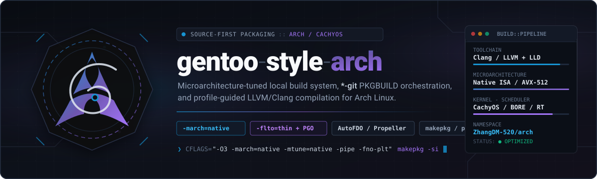

<p align="center"></p>

# Gentoo_Style_Arch — the recipe half

A curated Arch Linux package set, plus the declarative topology that orders it.
The engine that builds the set — `gsa` — lives in its own repository,
[ZhangDM-520/gentoo-style-arch](https://github.com/ZhangDM-520/gentoo-style-arch);
this repository is the data that engine consumes.

The set exists to rebuild a large, dependency-coupled desktop and toolchain
stack from `PKGBUILD` recipes with one command: the engine resolves the build
order from `config/topology.conf`, builds and installs each package before its
consumers compile, and keeps the whole run accountable — plan, outcome, and
continuation — as one run record. Everything is tuned to the machine that
builds it, so the result is a local, self-optimizing system rather than a
binary distribution.

The project targets **AMD laptops** (amdgpu/radeon) on Arch x86_64. Recipes may
trim Intel- and NVIDIA-only firmware and code paths; ISA settings are derived
from the build environment, never pinned. Built packages are not
redistributable binaries — they are tuned to the building machine.

## What is here

- **Recipes** — `packages/<category>/<package-id>/`: one `PKGBUILD` per recipe
  with its committed `.SRCINFO`, local patches and assets, and upstream license
  material. The physical categories (`git`, `stable`, `core`, `misc`, plus the
  reserved `deprecated` tier) are a filing system, not the build order.
- **Topology** — `config/topology.conf` binds each package id to its path, its
  groups, and its local build-order edges; `config/build-defaults.conf` holds
  lanes/jobs/intensity and the memory budgets; `config/abi-exclusions.conf`
  holds the reviewed ABI-exclusion rows. The engine validates the whole map on
  every invocation.
- **Shared recipe modules** — `lib/` (`pgo.sh` and the source-sharing helpers)
  and the recipe test battery under `tests/`.
- **Host diagnostics** — `tools/` (outside the battery: heavy and mutating).

The engine (`crates/`, the `format: 2` run record, the `gsa` binary) is not
here. `packages/core/gsa-pm` is the one recipe that builds it — a bootstrap
recipe, so a broken engine is always recoverable with plain `makepkg`.

## Quickstart

The engine is a package like any other, so the first build is plain `makepkg`.
On an Arch-based system:

```sh
git clone https://github.com/ZhangDM-520/gsa-recipe
cd gsa-recipe
sudo pacman -S --needed base-devel git rust
GIT_CONFIG_COUNT=0 makepkg -f --dir packages/core/gsa-pm   # builds the engine
sudo pacman -U packages/core/gsa-pm/gsa-pm-*.pkg.tar.zst
```

From then on, `gsa` runs every build. It finds this repository from the
`project` key in `gsa.conf`, from the current directory inside the checkout, or
from the canonical recipe store that `sudo gsa -Sy` fetches and refreshes.

Inspect before building anything:

```sh
gsa --help          # the authoritative command roster
gsa -Sl @git        # the set, in build order
gsa -S --dry-run @git
```

Then build. Selection is mandatory — a bare invocation never starts an
unattended rebuild — and a selection expands to the named packages plus
everything that must rebuild after them:

```sh
sudo gsa -S @git         # build + install, consumers included
sudo gsa -S glib2-git    # one package and its consumers
gsa -B --leaf glib2-git  # just this one, archives only
```

`-S` installs each package before its consumers compile; `-B` builds to
archives and installs nothing.

## The mental model

- **Topology, not directory names.** A package's identity, group membership
  and build-order edges are one declarative record; the engine re-validates the
  whole map on every run.
- **Consumers, not dependencies.** Rebuilding a package also rebuilds
  everything that must build after it — the ABI risk lives in its consumers.
- **One run, one record.** Plan, per-package outcomes and the continuation are
  computed once and rendered as dashboard, prose, and machine output.
- **Fail closed.** A failed package parks its consumer cone and the run says
  exactly why; a refused install never touches pacman; an interrupted run
  prints the same record a finished one does.
- **The build runs as you.** The engine and pacman act as root; `makepkg` and
  all build-side tools run as your user.

## Read before building

Every `PKGBUILD` is executable shell code with the privileges and network
access `makepkg` has. Read the recipe and `SECURITY.md` before building or
installing anything you have not reviewed.

## Where to go next

| Document | What it answers |
| --- | --- |
| `AGENTS.md` | This repository's memory: rules, pitfalls, queue, and the shell-boundary hazards |
| `docs/JOURNAL.md` | The chronological log — one dense line per action |
| `docs/maintainer-guide.md` | Adding and updating recipes, version-synced releases, coupled stacks |
| `docs/package-policy.md` | What a recipe directory may hold versus what is fetched at build time |
| `docs/source-sharing.md` | The shared-source mirror contract and what qualifies as a canonical mirror |
| `docs/CURRENT.md` | The live umbriel stack snapshot |
| `docs/adr/` | The decisions that fought back: the shared PGO gate, the one-record topology |
| `CONTRIBUTING.md` | The recipe-change checklist and validation standard |
| `SECURITY.md` | Trust model and safe-operation rules |
| `CONTEXT.md` | The project's vocabulary |
| The engine repository | `docs/gsa-contract.md` (authoritative interface), `docs/build-guide.md`, `docs/architecture.md`, `docs/portability.md` |

## Licensing

`LICENSE` covers the scheduler and project documentation only. Recipes carry
upstream/AUR material under its own copyright, license, and source terms —
preserve each package's attribution and license files when redistributing or
modifying a recipe.
